  

  <a href="https://amirdev1883.github.io/"><kbd>Portfolio ↗</kbd></a> &nbsp;
  <a href="https://amirdev1883.github.io/projects.html"><kbd>Projects ↗</kbd></a> &nbsp;
  <a href="https://amirdev1883.github.io/resume.html"><kbd>Résumé ↗</kbd></a> &nbsp;
  <a href="https://www.linkedin.com/in/amiraranii/"><kbd>LinkedIn ↗</kbd></a>

I’m a Toronto-based software developer with a computer science background. I build applications and REST APIs with Django and use Python and SQL to analyze data and build dashboards.

## `ls projects/`

A Django social app with user profiles and posts. It uses PostgreSQL for storage and Celery with RabbitMQ for background jobs. The repository includes a Docker Compose setup.

A Django REST Framework API and web dashboard for creating, editing, and tracking tasks. It includes sign-in, SQLite, and interactive Swagger documentation.

My IBM Data Analyst capstone uses Python notebooks, SQLite queries, and an interactive dashboard to explore which tools developers use and what they want to use next. The project covers **18,845 respondents across 161 countries** from a subset of the 2024 Stack Overflow Developer Survey.

An evolving inventory and order management project that explores how to keep each organization’s data and workflows separate on a shared backend.

## `cat experience.log`

- **DadePardaz Co.** · Python Backend Developer Intern. Contributed to Django REST APIs, authentication, and PostgreSQL queries.
- **University of Kashan** · Computer science coursework in algorithms, databases, and operating systems.
- **Kashan Computer Science Association** · Volunteer member from June 2023 to June 2025. Helped with student events.

## `cat credentials.log`

- **Microsoft Certified: Azure AI Fundamentals (AI-900)** · Microsoft, May 2026
- **IBM Data Analyst Professional Certificate** · IBM
- **Junior Data Analyst Program** · NPower Canada, July 2026
- **Advanced Python Programming Training** · Maktabkhooneh

## `cat stack.toml`

| Area | Tools |
| --- | --- |
| Backend | Python, Django, Django REST Framework, PostgreSQL, SQLite |
| Infrastructure | Linux, Git, Docker, Redis, RabbitMQ, Celery |
| Analytics | SQL, Python, Seaborn, IBM Cognos |

## `cat contact.txt`

Open to co-op opportunities and collaboration on software projects.

[Email](mailto:amirdev1883@gmail.com) · [LinkedIn](https://www.linkedin.com/in/amiraranii/) · [Telegram](https://telegram.me/amirdev1883)
