  

  <a href="https://amirdev1883.github.io/"><strong>Portfolio</strong></a> ·
  <a href="https://amirdev1883.github.io/projects.html">All projects</a> ·
  <a href="https://amirdev1883.github.io/resume.html">Résumé</a> ·
  <a href="https://www.linkedin.com/in/amiraranii/">LinkedIn</a>

I build **Django applications and REST APIs** and use **Python and SQL** to turn data into dashboards. I’m currently studying computer networks, cloud engineering, and cybersecurity.

## Selected projects

<table width="100%">
  <tr>
    <td width="50%" valign="top">
      <a href="https://github.com/amirdev1883/djangosocialmedia"> <strong>Django Social Media</strong></a> 
      Profiles and posts backed by PostgreSQL, with background jobs in Celery and RabbitMQ. Runs locally with Docker Compose.
    </td>
    <td width="50%" valign="top">
      <a href="https://github.com/amirdev1883/Django-Internship-Assignment-"> <strong>Task Manager API</strong></a> 
      A Django REST Framework API and dashboard for tracking tasks, with sign-in, SQLite, and Swagger documentation.
    </td>
  </tr>
  <tr>
    <td width="50%" valign="top">
      <a href="https://github.com/amirdev1883/ibm-data-analyst-capstone"> <strong>Developer Technology Trends</strong></a> 
      IBM capstone that uses Python, SQL, and a dashboard to analyze responses from <strong>18,845 developers in 161 countries</strong> in the 2024 Stack Overflow survey.
    </td>
    <td width="50%" valign="top">
      <a href="https://github.com/amirdev1883/b2b-inventory-management"> <strong>B2B Inventory Management</strong></a> 
      A work-in-progress backend for managing inventory and orders while keeping each organization’s data and workflows separate.
    </td>
  </tr>
</table>

## Experience and education

- **DadePardaz Co.** · Python Backend Developer Intern. Contributed to Django REST APIs, authentication, and PostgreSQL queries.
- **University of Kashan** · Computer science coursework in algorithms, databases, and operating systems.
- **Kashan Computer Science Association** · Volunteered at student events from June 2023 to June 2025.

## Technical skills

| Area | Tools |
| --- | --- |
| Backend | Python, Django, Django REST Framework, PostgreSQL, SQLite |
| Infrastructure | Linux, Git, Docker, Redis, RabbitMQ, Celery |
| Data analytics | SQL, Python, Seaborn, IBM Cognos |

## Credentials

- **Microsoft Certified: Azure AI Fundamentals (AI-900)** · Microsoft, May 2026
- **IBM Data Analyst Professional Certificate** · IBM
- **Junior Data Analyst Program** · NPower Canada, July 2026
- **Advanced Python Programming Training** · Maktabkhooneh

## Contact

Open to co-op opportunities and software projects. [Email](mailto:amirdev1883@gmail.com) · [LinkedIn](https://www.linkedin.com/in/amiraranii/) · [Telegram](https://telegram.me/amirdev1883)
